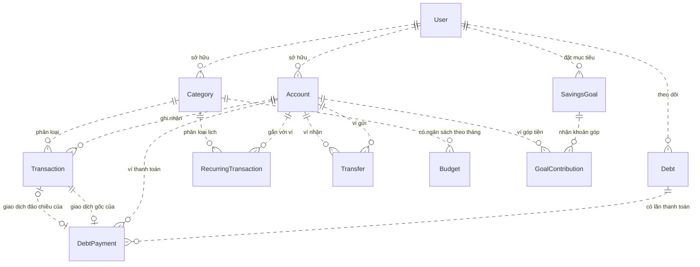

# Personal Finance API

REST API quản lý tài chính cá nhân với giao dịch thu chi, ví, ngân sách, chuyển tiền, tiết kiệm và công nợ. API phục vụ giao diện React có báo cáo theo tháng, dự báo dòng tiền, hồ sơ người dùng và khôi phục mật khẩu qua email.

## Công nghệ

| Thành phần | Sử dụng |
| --- | --- |
| Java | 21 |
| Spring Boot | 4.1.2 |
| Spring Web MVC | HTTP API và JSON |
| Spring Data JPA / Hibernate | Ánh xạ entity và truy cập database |
| H2 | Database file cục bộ |
| Jakarta Validation | Validation dữ liệu đầu vào |
| Spring Security | Bảo vệ endpoint và phân quyền theo user sở hữu dữ liệu |
| Spring Mail | Gửi email đặt lại mật khẩu qua SMTP |
| JJWT | Tạo, kiểm tra JWT Bearer token |
| Maven Wrapper | Build và chạy kiểm thử |

## Chạy dự án

Cần JDK 21. Maven Wrapper đã có sẵn nên không cần cài Maven riêng.

```bash
git clone https://github.com/ducanh181102/personal-finance-api.git
cd personal-finance-api
./mvnw spring-boot:run
```

Trên Windows dùng `mvnw.cmd spring-boot:run`. Ứng dụng mặc định chạy tại `http://localhost:8080`.

## Triển khai API và frontend trên VM

### Tạo VM Oracle Always Free

1. Đăng ký tài khoản tại [Oracle Cloud Free Tier](https://signup.cloud.oracle.com/) và hoàn tất xác minh theo yêu cầu Oracle.
2. Trong Cloud Console, vào **Compute → Instances → Create instance**. Chọn Ubuntu và shape `VM.Standard.A1.Flex` có nhãn **Always Free eligible**. Cấu hình 1 OCPU và 6 GB RAM đủ cho bản triển khai này. Chọn boot volume trong hạn mức Always Free.
3. Đặt VM trong public subnet và gán public IPv4. Cho phép SSH cổng 22 từ địa chỉ của máy quản trị, cùng TCP cổng 80 và 443 cho web trong cả quy tắc mạng OCI và tường lửa của VM.
4. Ở **Add SSH keys → Upload public key files**, dùng public key của máy quản trị. Nếu đã chuẩn bị khóa cho dự án này, file là `~/.ssh/personal-finance-oci.pub`.
5. Khi VM ở trạng thái **Running**, ghi lại **Public IP address** và **Username**. Ubuntu thường dùng tên đăng nhập `ubuntu`.

Các VM miễn phí phụ thuộc tài nguyên còn sẵn trong khu vực. [Tài nguyên Oracle Always Free](https://docs.oracle.com/en-us/iaas/Content/FreeTier/freetier_topic-Always_Free_Resources.htm)

### Chạy ứng dụng

Cài Docker và Docker Compose trên VM Linux. Đặt hai thư mục `personal-finance-api` và `personal-finance-frontend` cùng cấp. VM cần có địa chỉ IP công khai hoặc domain trỏ về VM và nhận kết nối TCP cổng 80 và 443 để Caddy cấp, gia hạn chứng chỉ HTTPS.

Trong thư mục backend, tạo file cấu hình cục bộ với địa chỉ công khai của VM. Dùng IP hoặc hostname, ví dụ `203.0.113.10`, rồi tạo khóa JWT mới.

```bash
umask 077
PUBLIC_HOST=203.0.113.10
printf 'PUBLIC_HOST=%s\nJWT_SECRET=%s\n' "$PUBLIC_HOST" "$(openssl rand -base64 32)" > deploy/.env
```

Để kích hoạt quên mật khẩu, thêm `SPRING_MAIL_USERNAME` và `SPRING_MAIL_PASSWORD` vào `deploy/.env`. Khi dùng Gmail SMTP, kiểm tra VM có kết nối được tới `smtp.gmail.com:587`.

```bash
docker compose --env-file deploy/.env -f deploy/compose.yaml up -d --build
```

Mở địa chỉ HTTPS đã cấu hình. Caddy phục vụ giao diện và chuyển `/api` tới Spring Boot trên mạng Docker. H2 lưu vào volume `finance_data` để dữ liệu còn sau khi cập nhật hoặc khởi động lại container. Lần chạy đầu tạo database mới. Dùng lại file `deploy/.env` khi cập nhật để giữ khóa JWT và cấu hình email.

## Xác thực và phân quyền

Đăng ký, đăng nhập và khôi phục tài khoản là endpoint public. Tất cả endpoint dữ liệu khác cần JWT trong header:

```http
Authorization: Bearer <accessToken>
```

| Method | Đường dẫn | Chức năng | Status thành công |
| --- | --- | --- | --- |
| POST | `/api/users` | Đăng ký user | 201 |
| POST | `/api/auth/login` | Đăng nhập, nhận JWT | 200 |
| POST | `/api/auth/reactivate` | Khôi phục user đã vô hiệu hóa | 200 |
| POST | `/api/auth/forgot-password` | Yêu cầu liên kết đặt lại qua email với `email` | 202 |
| POST | `/api/auth/reset-password` | Đặt lại bằng `token` và `password` mới | 204 |
| GET | `/api/users/me` | Xem user hiện tại | 200 |
| GET | `/api/users/accounts/me` | Danh sách tài khoản đang hoạt động của user | 200 |
| GET | `/api/users/categories/me` | Danh sách danh mục đang hoạt động của user | 200 |
| PATCH | `/api/users/me` | Cập nhật tên với `name`. Khi đổi `email` hoặc gửi `password` mới, cần thêm `currentPassword`. | 200 |
| PATCH | `/api/users/me/password` | Đổi mật khẩu với `currentPassword` và `newPassword`. Các JWT cũ hết hiệu lực. | 204 |
| DELETE | `/api/users/me` | Vô hiệu hóa user hiện tại | 204 |

Ví dụ đăng ký:

```json
{
  "name": "Đức Anh",
  "email": "anh@example.com",
  "password": "mat-khau-cua-ban"
}
```

Ví dụ đăng nhập:

```json
{
  "email": "anh@example.com",
  "password": "mat-khau-cua-ban"
}
```

Response login chứa `accessToken` và thông tin user, không bao giờ trả về `passwordHash`.

Trang **Hồ sơ và bảo mật** lấy thông tin tài khoản qua `GET /api/users/me` khi khôi phục phiên. Để đổi tên hiển thị, gửi `{"name":"Tên mới"}` tới `PATCH /api/users/me`. Đổi tên giữ phiên hiện tại.

Để đổi mật khẩu trong phiên đang đăng nhập, gửi `PATCH /api/users/me/password` cùng Bearer token và body sau.

```json
{
  "currentPassword": "<mật khẩu hiện tại>",
  "newPassword": "<mật khẩu mới>"
}
```

Mật khẩu hiện tại sai trả `400` và người dùng có thể nhập lại. Khi đổi thành công, backend cập nhật `sessionVersion` và xóa token khôi phục đã cấp. Frontend đưa người dùng về trang đăng nhập, còn các JWT cũ nhận `401` khi gọi API.

User chỉ có thể xem, tạo, sửa hoặc xóa dữ liệu thuộc chính họ: Account, Category, Transaction, Budget, Transfer, Savings Goal, Goal Contribution, Debt và Debt Payment. Không có token, token sai/hết hạn trả `401`; có token nhưng truy cập dữ liệu của user khác trả `403`.

`DELETE /api/users/me` là **soft delete**: đặt `active = false`, không xóa lịch sử tài chính. Khi user bị vô hiệu hóa, API từ chối token của user. Gửi `email` và `oldPassword` đến `/api/auth/reactivate` để khôi phục user và nhận token mới.

### Gửi email đặt lại mật khẩu

Đặt các biến môi trường sau trước khi chạy Spring Boot. Nếu chạy từ IntelliJ, đặt chúng trong cấu hình chạy ứng dụng.

Ứng dụng đã đặt mặc định máy chủ Gmail, cổng 587, xác thực SMTP và STARTTLS. Để gửi bằng Gmail, bật xác minh hai bước và tạo Mật khẩu ứng dụng cho tài khoản gửi theo [hướng dẫn của Google](https://support.google.com/accounts/answer/185833?hl=vi). Trong IntelliJ, mở **Run → Edit Configurations → cấu hình Spring Boot → Environment variables**, thêm `SPRING_MAIL_USERNAME` là Gmail gửi thư và `SPRING_MAIL_PASSWORD` là Mật khẩu ứng dụng, rồi khởi động lại backend.

Bạn cũng có thể đặt `spring.mail.username` và `spring.mail.password` trong `config/mail-local.properties` ở thư mục gốc dự án. Spring Boot tự đọc file này khi khởi động, file được loại khỏi Git. Các biến môi trường tương ứng được ưu tiên khi được cấu hình.

| Biến môi trường | Giá trị |
| --- | --- |
| `SPRING_MAIL_HOST` | Mặc định `smtp.gmail.com`, có thể thay bằng máy chủ SMTP khác |
| `SPRING_MAIL_PORT` | Mặc định `587` cho STARTTLS |
| `SPRING_MAIL_USERNAME`, `SPRING_MAIL_PASSWORD` | Thông tin xác thực SMTP do nhà cung cấp cấp |
| `PASSWORD_RESET_SMTP_AUTH` | Mặc định `true`, đặt theo yêu cầu của máy chủ SMTP |
| `PASSWORD_RESET_SMTP_STARTTLS` | Mặc định `true`, đặt theo yêu cầu của máy chủ SMTP |
| `PASSWORD_RESET_FROM` | Địa chỉ người gửi được nhà cung cấp cho phép, mặc định dùng `SPRING_MAIL_USERNAME` |
| `PASSWORD_RESET_FRONTEND_URL` | URL frontend mà người nhận mở được, mặc định `http://localhost:5174`. Dùng địa chỉ Mac trong cùng Wi-Fi khi thử trên điện thoại và HTTPS khi triển khai. |

Để thử cục bộ với [Mailpit](https://mailpit.axllent.org/docs/), đặt `SPRING_MAIL_HOST=127.0.0.1`, `SPRING_MAIL_PORT=1025`, `PASSWORD_RESET_FROM=no-reply@example.test`, `PASSWORD_RESET_SMTP_AUTH=false` và `PASSWORD_RESET_SMTP_STARTTLS=false`. Mở hộp thư thử tại `http://localhost:8025`.

`POST /api/auth/forgot-password` trả `202` khi yêu cầu được đưa vào hàng đợi. Backend gửi thư cho tài khoản đang hoạt động và gửi lại tối đa một lần mỗi phút cho cùng tài khoản. Khi thiếu cấu hình SMTP hoặc địa chỉ gửi, API trả `503`.

Email có mẫu HTML với nút **Đặt mật khẩu mới**, kèm bản văn bản dùng cùng liên kết. Backend lưu bản băm SHA-256 của token. React đọc token từ phần `#token=...` rồi gửi cùng mật khẩu mới tới API. Liên kết dùng một lần trong 15 phút. Đặt lại thành công hết hiệu lực các JWT đã cấp trước đó. [Mẫu email đặt lại mật khẩu](src/main/resources/templates/mail/password-reset.html)

## Sơ đồ quan hệ dữ liệu



- `TransactionType` chỉ có `INCOME` và `EXPENSE`.
- Transaction phải có category cùng type với transaction.
- Chỉ category `EXPENSE` mới tạo được budget, tối đa một budget cho mỗi category trong một tháng.
- Budget không lưu số tiền đã chi; số tiền này luôn được tính từ các transaction.
- `RecurringTransaction` là mẫu giao dịch lặp lại. Khi đến hạn, scheduler tạo `Transaction` với `source=RECURRING`. Bản ghi giao dịch không lưu khóa ngoại về mẫu.
- `Transfer` di chuyển tiền giữa hai Account cùng thuộc một user.
- `SavingsGoal` theo dõi một mục tiêu tiết kiệm; `GoalContribution` là từng lần góp vào mục tiêu.
- `DebtPayment` luôn liên kết với giao dịch thanh toán gốc qua `transaction_id`. Khi hủy thanh toán, giao dịch gốc được giữ và `reversal_transaction_id` trỏ đến giao dịch đảo chiều.

## API

Tất cả request có body JSON cần header `Content-Type: application/json`.

### Account

| Method | Đường dẫn | Chức năng | Status thành công |
| --- | --- | --- | --- |
| GET | `/api/accounts` | Danh sách tài khoản | 200 |
| GET | `/api/accounts/{id}` | Xem một tài khoản | 200 |
| POST | `/api/accounts` | Tạo tài khoản | 201 |
| PATCH | `/api/accounts/{id}` | Đổi tên tài khoản | 200 |
| POST | `/api/accounts/{id}/archive` | Lưu trữ tài khoản | 204 |
| POST | `/api/accounts/{id}/activate` | Kích hoạt lại tài khoản | 204 |
| DELETE | `/api/accounts/{id}` | Xóa tài khoản | 204 |

```json
{
  "name": "Ví tiền mặt",
  "type": "CASH",
  "openingBalance": 500000
}
```

Khi tạo tài khoản, `type` nhận một trong các mã `CASH` (Tiền mặt), `BANK` (Ngân hàng), `E_WALLET` (Ví điện tử) và `OTHER` (Khác). API vẫn trả về giá trị đã lưu của tài khoản cũ.

Danh sách mặc định chỉ trả tài khoản `ACTIVE`. Dùng `includeArchived=true` để lấy cả tài khoản `ARCHIVED`. Lưu trữ giữ nguyên lịch sử giao dịch và tạm dừng các mẫu định kỳ gắn với tài khoản.

### Category

| Method | Đường dẫn | Chức năng | Status thành công |
| --- | --- | --- | --- |
| GET | `/api/categories` | Danh sách danh mục | 200 |
| GET | `/api/categories/{id}` | Xem một danh mục | 200 |
| POST | `/api/categories` | Tạo danh mục | 201 |
| PATCH | `/api/categories/{id}` | Đổi tên hoặc type | 200 |
| POST | `/api/categories/{id}/archive` | Lưu trữ danh mục | 204 |
| POST | `/api/categories/{id}/activate` | Kích hoạt lại danh mục | 204 |
| DELETE | `/api/categories/{id}` | Xóa danh mục | 204 |

```json
{
  "name": "Ăn uống",
  "type": "EXPENSE"
}
```

Category đang được transaction sử dụng không thể bị xóa. Type của category đang được sử dụng cũng không thể đổi, vì sẽ làm dữ liệu transaction cũ bị lệch nghiệp vụ.

Danh sách mặc định chỉ trả danh mục `ACTIVE`. Dùng `includeArchived=true` để lấy cả danh mục `ARCHIVED`. Backend tự tạo và bảo vệ các danh mục hệ thống dùng cho thanh toán nợ và giao dịch đảo chiều. Lưu trữ danh mục sẽ tạm dừng các mẫu định kỳ gắn với danh mục đó.

### Transfer

| Method | Đường dẫn | Chức năng | Status thành công |
| --- | --- | --- | --- |
| GET | `/api/transfers` | Danh sách giao dịch chuyển tiền | 200 |
| GET | `/api/transfers/{id}` | Xem một giao dịch chuyển tiền | 200 |
| POST | `/api/transfers` | Chuyển tiền giữa hai account | 201 |
| DELETE | `/api/transfers/{id}` | Xóa bản ghi chuyển tiền nhập sai | 204 |

```json
{
  "fromAccountId": 1,
  "toAccountId": 2,
  "amount": 200000,
  "transferDate": "2026-11-10T10:00:00",
  "note": "Chuyển sang ví ngân hàng"
}
```

Hai account phải cùng thuộc user hiện tại và không được trùng nhau. Transfer không có `PATCH`; nếu nhập sai thì xóa và tạo lại. Khi tính số dư, account gửi bị trừ và account nhận được cộng số tiền transfer.

### Transaction

| Method | Đường dẫn | Chức năng | Status thành công |
| --- | --- | --- | --- |
| GET | `/api/transactions` | Toàn bộ giao dịch của user hiện tại | 200 |
| GET | `/api/transactions/page` | Danh sách có bộ lọc, sắp xếp và phân trang | 200 |
| GET | `/api/transactions/category/{categoryId}` | Danh sách giao dịch theo danh mục | 200 |
| GET | `/api/transactions/{id}` | Xem một giao dịch | 200 |
| POST | `/api/transactions` | Tạo giao dịch | 201 |
| PATCH | `/api/transactions/{id}` | Sửa amount, type hoặc note | 200 |
| DELETE | `/api/transactions/{id}` | Xóa giao dịch | 204 |

Ví dụ tạo khoản chi:

```json
{
  "accountId": 1,
  "categoryId": 1,
  "type": "EXPENSE",
  "amount": 120000,
  "transactionDate": "2026-11-08T12:30:00",
  "note": "Ăn trưa"
}
```

`transactionDate` là bắt buộc, dùng định dạng `YYYY-MM-DDTHH:mm:ss` và không được ở tương lai.

Ví dụ dùng `/api/transactions/page` để lọc và phân trang:

```text
GET /api/transactions/page?accountId=1&page=0&size=10
GET /api/transactions/page?from=2026-11-01&to=2026-11-30&sort=ASC
GET /api/transactions/page?categoryId=2&type=EXPENSE&source=MANUAL&minAmount=10000&maxAmount=100000&keyword=trua
```

| Tham số | Hành vi |
| --- | --- |
| `accountId`, `categoryId` | Tùy chọn. Bỏ `accountId` để lọc trên tất cả tài khoản của user hiện tại |
| `from`, `to` | Gửi cùng nhau theo `YYYY-MM-DD`. Khoảng lọc tính cả hai ngày, với `from <= to` |
| `minAmount`, `maxAmount` | Gửi cùng nhau. Kết quả tính cả hai đầu mút và yêu cầu `minAmount <= maxAmount` |
| `type`, `source` | Lọc theo loại và nguồn giao dịch |
| `keyword` | Tìm trong ghi chú, không phân biệt chữ hoa và chữ thường |
| `sort` | `ASC` hoặc `DESC` theo ngày giao dịch, mặc định `DESC` |
| `page`, `size` | `page` bắt đầu từ `0`, `size` từ `1` đến `100` và mặc định là `10` |

`source` gồm `MANUAL`, `RECURRING`, `DEBT_PAYMENT` và `DEBT_PAYMENT_REVERSAL`. Chỉ giao dịch `MANUAL` có thể sửa hoặc xóa trực tiếp.

Response phân trang có cấu trúc ổn định:

```json
{
  "content": [],
  "page": 0,
  "size": 10,
  "totalElements": 0,
  "totalPages": 0,
  "first": true,
  "last": true
}
```

### Recurring transaction

Recurring transaction là mẫu cho các khoản lặp lại như lương, tiền trọ hoặc tiền điện. Mẫu không được tính vào dashboard cho đến khi scheduler tạo ra `Transaction` thật.

| Method | Đường dẫn | Chức năng | Status thành công |
| --- | --- | --- | --- |
| GET | `/api/recurring-transactions` | Danh sách mẫu giao dịch định kỳ của user hiện tại | 200 |
| GET | `/api/recurring-transactions/{id}` | Xem một mẫu | 200 |
| POST | `/api/recurring-transactions` | Tạo mẫu | 201 |
| PATCH | `/api/recurring-transactions/{id}` | Cập nhật mẫu hoặc tạm dừng/kích hoạt lại | 200 |
| DELETE | `/api/recurring-transactions/{id}` | Xóa mẫu, không xóa lịch sử giao dịch đã sinh | 204 |

Ví dụ tạo khoản tiền trọ mỗi tháng:

```json
{
  "accountId": 1,
  "categoryId": 2,
  "amount": 3000000,
  "note": "Tiền trọ hằng tháng",
  "frequency": "MONTHLY",
  "nextRunDate": "2026-12-05"
}
```

`active=false` tạm dừng mẫu. `active=true` chỉ kích hoạt lại khi cả tài khoản và danh mục đang hoạt động. Khi cập nhật bằng `PATCH`, không gửi field nào thì field đó được giữ nguyên.

Scheduler tự chạy khi ứng dụng khởi động và mỗi ngày lúc `00:05` theo múi giờ `Asia/Ho_Chi_Minh`. Nó tìm các mẫu `active` có `nextRunDate` đã đến hạn, tạo `Transaction` thật với ngày giao dịch bằng `nextRunDate`, sau đó dời lịch sang tháng kế tiếp. Nếu server từng tắt nhiều tháng, scheduler tạo bù toàn bộ kỳ bị lỡ trong một lần chạy.

### Báo cáo tài khoản

| Method | Đường dẫn | Dữ liệu trả về |
| --- | --- | --- |
| GET | `/api/accounts/{id}/balance` | Số dư hiện tại |
| GET | `/api/accounts/{id}/summary` | Tổng thu, tổng chi và số dư hiện tại |
| GET | `/api/accounts/{id}/period-summary?from=...&to=...` | Tổng thu, chi và chênh lệch trong kỳ |
| GET | `/api/accounts/{id}/category-summary?from=...&to=...` | Tổng tiền theo từng category trong kỳ |

```text
GET /api/accounts/1/category-summary?from=2026-11-01&to=2026-11-30
```

Số dư hiện tại của account được tính theo công thức:

```text
openingBalance + income - expense + transferIn - transferOut
```

### Budget

| Method | Đường dẫn | Chức năng | Status thành công |
| --- | --- | --- | --- |
| GET | `/api/budgets` | Danh sách budget | 200 |
| GET | `/api/budgets/{id}` | Xem một budget | 200 |
| POST | `/api/budgets` | Tạo budget | 201 |
| PATCH | `/api/budgets/{id}` | Chỉ đổi hạn mức | 200 |
| DELETE | `/api/budgets/{id}` | Xóa budget | 204 |
| GET | `/api/budgets/{id}/summary` | Tổng quan một budget | 200 |
| GET | `/api/budgets/summary?month=YYYY-MM-01` | Tổng quan mọi budget trong tháng | 200 |
| GET | `/api/budgets/alerts?month=YYYY-MM-01` | Các budget đạt ngưỡng cảnh báo hoặc vượt hạn mức | 200 |
| POST | `/api/budgets/copy-from-previous-month?targetMonth=YYYY-MM-01` | Sao chép budget còn thiếu từ tháng trước | 200 |

```json
{
  "categoryId": 1,
  "month": "2026-11-01",
  "limitAmount": 3000000
}
```

`month` bắt buộc là ngày đầu tháng. Mỗi category chỉ có một budget trong một tháng.

Ví dụ response summary:

```json
{
  "budgetId": 1,
  "categoryId": 1,
  "categoryName": "Ăn uống",
  "month": "2026-11-01",
  "limitAmount": 100000,
  "spentAmount": 120000,
  "remainingAmount": -20000,
  "usagePercentage": 120.00,
  "overBudget": true,
  "status": "EXCEEDED"
}
```

`spentAmount` là tổng giao dịch của category trong tháng. `remainingAmount = limitAmount - spentAmount`; `overBudget` là `true` khi số đã chi lớn hơn hạn mức. Theo `usagePercentage`, `status` là `SAFE` khi dưới 80%, `WARNING` từ 80% đến 100%, và `EXCEEDED` khi trên 100%.

### Dashboard

`GET /api/dashboard/monthly?month=YYYY-MM-01` trả tổng thu, tổng chi, chênh lệch, số tài khoản, số ngân sách và số ngân sách vượt hạn mức trong tháng.

### Báo cáo thu chi

`GET /api/reports/monthly?month=YYYY-MM-01` trả hai kỳ `current` và `previous`. Mỗi kỳ gồm `month`, `totalIncome`, `totalExpense`, `netChange` và `categories` với `categoryId`, `categoryName`, `type`, `totalAmount`. Báo cáo cộng giao dịch của tất cả ví thuộc người dùng hiện tại, kể cả ví đã lưu trữ. Các lần chuyển tiền nội bộ thuộc lịch sử chuyển tiền.

### Dự báo dòng tiền

`GET /api/reports/cash-flow-forecast?days=30` yêu cầu đăng nhập và trả từ 1 đến 365 ngày, mặc định 30 ngày tính cả hôm nay theo giờ Việt Nam. Số dư đầu kỳ là tổng số dư các ví, kể cả ví đã lưu trữ. Chuyển tiền nội bộ có tổng ảnh hưởng bằng 0.

Mỗi phần tử trong `days` gồm ngày, thu, chi, số dư cuối ngày dự kiến và các khoản dự kiến. API tính lịch định kỳ đang hoạt động và số tiền còn lại của khoản nợ đang mở. Khoản đến hạn trước kỳ dự báo được tính vào hôm nay và giữ ngày gốc trong `scheduledDate`. Trường `firstShortfallDate` là ngày đầu tiên có số dư cuối ngày âm, hoặc `null` khi số dư cuối ngày luôn từ 0 trở lên.

### Savings Goal

| Method | Đường dẫn | Chức năng | Status thành công |
| --- | --- | --- | --- |
| GET | `/api/savings-goals` | Danh sách mục tiêu tiết kiệm | 200 |
| GET | `/api/savings-goals/{id}` | Xem một mục tiêu | 200 |
| POST | `/api/savings-goals` | Tạo mục tiêu | 201 |
| PATCH | `/api/savings-goals/{id}` | Đổi tên, số tiền mục tiêu hoặc hạn hoàn thành | 200 |
| DELETE | `/api/savings-goals/{id}` | Xóa mục tiêu chưa có khoản góp | 204 |

```json
{
  "name": "Mua laptop",
  "targetAmount": 25000000,
  "deadline": "2027-06-01"
}
```

`currentAmount` và `completed` do hệ thống quản lý, client không được sửa trực tiếp. Khi `currentAmount >= targetAmount`, mục tiêu chuyển sang `completed = true`.

### Goal Contribution

| Method | Đường dẫn | Chức năng | Status thành công |
| --- | --- | --- | --- |
| GET | `/api/goal-contributions` | Danh sách các lần góp | 200 |
| GET | `/api/goal-contributions/{id}` | Xem một lần góp | 200 |
| POST | `/api/goal-contributions` | Góp tiền vào mục tiêu | 201 |
| DELETE | `/api/goal-contributions/{id}` | Xóa lần góp nhập sai | 204 |

```json
{
  "savingsGoalId": 1,
  "accountId": 1,
  "amount": 500000,
  "contributedAt": "2026-11-10T10:00:00",
  "note": "Góp tháng 11"
}
```

Tạo contribution làm tăng `currentAmount`; xóa contribution làm giảm lại giá trị này. Mục tiêu đã có contribution không thể xóa cho đến khi xóa hết các contribution liên quan.

### Debt

`DebtType` gồm `LENT` (người khác nợ mình) và `BORROWED` (mình nợ người khác). `DebtStatus` gồm `OPEN` và `PAID`.

| Method | Đường dẫn | Chức năng | Status thành công |
| --- | --- | --- | --- |
| GET | `/api/debts` | Danh sách khoản nợ | 200 |
| GET | `/api/debts/{id}` | Xem một khoản nợ | 200 |
| GET | `/api/debts/alerts?days=7` | Khoản nợ còn mở đã quá hạn hoặc sắp đến hạn | 200 |
| POST | `/api/debts` | Tạo khoản nợ | 201 |
| PATCH | `/api/debts/{id}` | Đổi người liên quan, hạn thanh toán hoặc ghi chú | 200 |
| DELETE | `/api/debts/{id}` | Xóa debt chưa có payment | 204 |

```json
{
  "personName": "Nam",
  "type": "LENT",
  "originalAmount": 2000000,
  "dueDate": "2026-12-31",
  "note": "Cho Nam mượn"
}
```

Khi tạo debt: `remainingAmount = originalAmount`, `status = OPEN`. `originalAmount` và `type` không được sửa trực tiếp sau khi tạo.

### Debt Payment

| Method | Đường dẫn | Chức năng | Status thành công |
| --- | --- | --- | --- |
| GET | `/api/debt-payments` | Danh sách lần thanh toán nợ | 200 |
| GET | `/api/debt-payments/{id}` | Xem một lần thanh toán | 200 |
| POST | `/api/debt-payments` | Tạo lần thanh toán | 201 |
| POST | `/api/debt-payments/{id}/cancel` | Hủy lần thanh toán và tạo giao dịch đảo chiều | 200 |

```json
{
  "debtId": 1,
  "accountId": 1,
  "amount": 500000,
  "paidAt": "2026-11-10T10:00:00",
  "note": "Trả lần đầu"
}
```

Mỗi payment làm giảm `remainingAmount` và sinh giao dịch `DEBT_PAYMENT`, ảnh hưởng đến số dư tài khoản. Khoản vay tạo giao dịch chi, khoản cho mượn tạo giao dịch thu khi thu hồi nợ. Khi `remainingAmount` bằng `0`, debt chuyển sang `PAID`.

Khi hủy, payment chuyển sang `CANCELLED`, tiền được cộng lại vào số nợ còn lại và debt trở về `OPEN`. API giữ giao dịch gốc và tạo giao dịch `DEBT_PAYMENT_REVERSAL` để đảo ảnh hưởng lên số dư. Response trả `transactionId`, `reversalTransactionId` và `cancelledAt` để đối chiếu lịch sử.

## Validation và lỗi

- Các ID phải lớn hơn `0`.
- Amount và limit amount phải dương, tối đa 17 chữ số phần nguyên và 2 chữ số thập phân.
- Category của transaction phải có type trùng với transaction.
- Không thể tạo budget cho category `INCOME`.
- `from` không được sau `to`.
- Không thể xóa Account hoặc Category đã có dữ liệu đang tham chiếu đến chúng.
- Không thể chuyển tiền sang account của user khác, góp tiền vào goal của user khác, hoặc thanh toán debt của user khác.
- Không thể trả debt vượt `remainingAmount`.

Validation hoặc lỗi nghiệp vụ trả `400 Bad Request`, ví dụ:

```json
{
  "transactionDate": "Thời gian giao dịch không được ở tương lai"
}
```

Đối tượng không tồn tại trả `404 Not Found`:

```json
{
  "message": "Không tìm thấy đối tượng có ID: 99"
}
```

## Database

```properties
spring.datasource.url=jdbc:h2:file:./data/personalfinance;DB_CLOSE_ON_EXIT=FALSE
spring.jpa.hibernate.ddl-auto=update
```

H2 lưu data tại `data/personalfinance.mv.db`. Nếu thay đổi entity theo cách không tương thích với dữ liệu cũ khi đang học, dừng ứng dụng rồi xóa file database để Hibernate tạo schema mới. Thao tác này xóa toàn bộ dữ liệu cục bộ.

## Kiểm thử

```bash
./mvnw clean test -Dspring.datasource.url=jdbc:h2:mem:personalfinance-test
```

Các test hiện kiểm tra:

- Spring context khởi động.
- Báo cáo theo kỳ tính đúng thu, chi và chênh lệch.
- Khoảng ngày không hợp lệ trả `400`.
- Budget summary tính đúng tổng chi, phần trăm sử dụng, trạng thái vượt hạn mức và không lấy giao dịch của tháng sau.
- JWT bắt buộc cho API protected, owner truy cập được dữ liệu của mình và user khác nhận `403`.
- List/pagination không làm lộ Transaction hoặc Budget của user khác.
- Không thể xóa Account đã có Transaction; Account trống xóa thành công.
- Soft delete từ chối token cũ; khôi phục user trả token mới dùng được.
- Đổi tên giữ phiên đăng nhập. Đổi mật khẩu yêu cầu mật khẩu hiện tại và vô hiệu hóa JWT cũ.
- Email đặt lại có hai phiên bản HTML và văn bản cùng dùng một liên kết. Backend từ chối token hết hạn hoặc đã dùng.
- Dự báo dòng tiền tính lịch định kỳ, công nợ và ngày đầu tiên có số dư dự kiến âm.
- Recurring scheduler tạo bù đủ transaction bị lỡ, không xử lý mẫu đã tạm dừng và dời đúng `nextRunDate`.
- Transfer làm số dư account gửi giảm, account nhận tăng; user khác không được dùng account không thuộc họ.
- Savings Goal cập nhật số tiền góp và trạng thái hoàn thành; không thể xóa goal đã có contribution.
- Debt Payment cập nhật số nợ còn lại, đóng/mở debt đúng lúc, chặn trả vượt nợ và chặn user khác truy cập.

## Cấu trúc source

```text
src/main/java/com/example/personalfinance/
├── controller/   # HTTP request/response
├── config/       # PasswordEncoder và Spring Security configuration
├── dto/
│   ├── account/      # DTO của account và báo cáo account
│   ├── auth/         # Đăng nhập, khôi phục tài khoản và đặt lại mật khẩu
│   ├── budget/       # DTO budget và budget summary
│   ├── category/     # DTO category và category summary
│   ├── common/       # DTO dùng chung, ví dụ PageResponse
│   ├── dashboard/    # DTO tổng quan dashboard
│   ├── debt/         # DTO khoản nợ
│   ├── debtpayment/  # DTO thanh toán nợ
│   ├── goalcontribution/ # DTO góp mục tiêu tiết kiệm
│   ├── recurring/    # DTO giao dịch định kỳ
│   ├── report/       # DTO báo cáo thu chi và dự báo dòng tiền
│   ├── savingsgoal/  # DTO mục tiêu tiết kiệm
│   ├── transaction/  # DTO giao dịch
│   ├── transfer/     # DTO chuyển tiền
│   └── user/         # DTO user
├── exception/    # Xử lý lỗi chung
├── mapper/       # Chuyển entity thành response DTO
├── model/        # JPA entities
├── repository/   # Spring Data JPA
├── scheduler/    # Tác vụ tự chạy theo thời gian
├── security/     # JWT service và authentication filter
└── service/      # Nghiệp vụ
```

`src/main/resources/templates/mail/` chứa mẫu email HTML. Request đi qua Controller, Service và Repository để đọc hoặc ghi dữ liệu.
